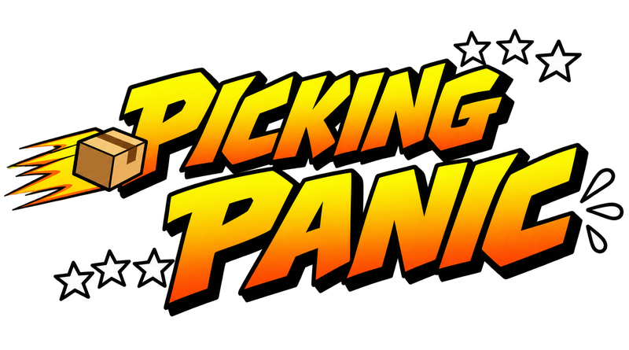

  

# Picking Panic 📦⏱️

Jogo 2D de vista aérea, no estilo do GTA 1, ambientado num galpão de logística.
Você é um operador correndo contra o relógio: pedidos caem no balcão do WMS, você separa, embala e expede antes do caminhão sair. E ainda tem empilhadeira, coletor perdido e Black Friday.

## Como jogar

Abra o `index.html` no navegador ou jogue pelo GitHub Pages. As 6 fases são jogadas em sequência: terminou uma, vai para a próxima, até zerar o jogo. No final aparece o tempo total da campanha.

| Tecla | Ação |
|---|---|
| Setas | Andar (ou dirigir, nas fases de empilhadeira) |
| Shift | Correr |
| E | Interagir / abrir o balcão WMS / segurar para coletar ou erguer o garfo |
| C | Pegar ou soltar o carrinho de picking |
| Q | Ver a etiqueta (empilhadeira: ordem de serviço) |
| H | Buzina (dirigindo) |
| R / M | Rádio caipira / som |
| Esc | Pausar |

Não precisa decorar: as dicas aparecem na hora certa, na primeira vez que cada coisa surge. Para vê-las de novo, use **Pausa → Mostrar dicas de novo**.

**Carrinho de picking:** fica perto do balcão nas fases a pé. Com ele você anda mais rápido e corre mesmo carregado, mas ele é mais largo e também leva batida de empilhadeira.

### No celular

Funciona em pé ou deitado: o mapa se ajusta ao formato da tela. Não tem joystick fixo:

- **Deslize o dedo** em qualquer lugar da tela: o operador anda na direção do deslize. Deslizando mais longe, ele corre. Um círculo mostra onde o dedo encostou.
- **Botão amarelo:** aparece só quando tem algo para fazer ali. Segure para coletar.
- **Empilhadeira:** deslize para onde ela deve ir. Deslizando para trás dela, ela dá ré. O botão azul é a buzina.
- **Toque no tempo** para pausar e **no objetivo** para ver a etiqueta.
- **Embalagem:** deslize o dedo na direção de cada seta e toque para o E, ou use os botões.
- **Garfo:** segure em qualquer lugar da tela (ou no botão) e solte na faixa verde.
- **Tempo:** no celular, as estrelas e a bateria do coletor têm 35% a mais de tempo, e o recorde fica separado do recorde do computador.

## Balcão WMS: como os pedidos chegam

Nas fases de picking, o turno começa com você colado no balcão do WMS. Os pedidos **caem no balcão** com um "plim", o contador 📥 no HUD e papéis empilhando no balcão. Quanto mais você demora, mais pedidos se acumulam, e cada um tem um prazo que conta desde que caiu.

1. Enquanto tiver pedido esperando, um marcador amarelo pulsa na frente do balcão e um aviso fixo diz o que fazer: chegar no balcão e apertar **E** (no celular, o botão **PEGAR PEDIDO**).
2. O cupom do pedido mais urgente sai impresso na hora, numa janela só. Com mais de um na fila, **◀ ▶** troca de pedido; **Esc** deixa para depois.
3. Separe, embale e deposite no pallet da doca do pedido.
4. O caminhão sai e abre a janela de **pedido concluído** (estrelas, tempo, prazo, penalidades). Depois, volta pro galpão.
5. Pedido entregue fora do prazo custa +5s. Quando o último pedido sai, aparece o relatório da fase.

As dicas de controle aparecem uma vez, como legenda curta no rodapé (no celular, logo abaixo do topo), sem cobrir o jogador.

## Fase 1: Pedido #1042

Pegue o pedido no balcão, separe 4 volumes em 3 endereços (R01-P04, R03-P07 e R04-P13) na ordem que quiser, embale na bancada e coloque a caixa lacrada no pallet da DOCA 2. Três empilhadeiras circulam pelo galpão, e encostar em qualquer uma custa +5s.

## Fase 2: Pallet no Alto

Suba na Empilhadeira 04, dirija até o pulmão PUL-02, alinhe os garfos de frente para o rack e erga até o nível 3. Depois leve o pallet até a área demarcada da DOCA 1. A direção é no estilo GTA 1, com inércia. Bater no rack custa +3s, passar rápido na faixa de pedestre dá multa de +2s e encostar em pedestre custa +5s.

## Fase 3: Cadê o Coletor?

O coletor sumiu, e sem ele não tem seta nem minimapa. Siga o bip, que fica mais alto e mais de um lado conforme você chega perto, ou acompanhe a barra de SINAL no HUD. Os colegas dão pistas com E, mas um deles mente. Se a bateria acabar, a fase recomeça. Achou o coletor? O WMS religa, a etiqueta imprime e ainda tem um pedido de 2 itens para fechar.

## Fase 4: Fila no Balcão

Dois pedidos no turno: o segundo cai enquanto você ainda está no primeiro. Docas diferentes, prazos diferentes.

## Fase 5: Chegou Carga

O caminhão do fornecedor encostou na DOCA 2. Suba na empilhadeira, encaixe o garfo em cada pallet da área de recebimento (de frente para a doca, em cima da marca) e guarde no pulmão: o P1 vai no PUL-01, nível 2, e o P2 no PUL-03, nível 3. Guardou os dois, o caminhão vazio vai embora.

## Fase 6: Black Friday

Três pedidos caindo em sequência, com prazos apertados. Se demorar, a fila cresce e os prazos estouram. Escolha a ordem pela caixa de entrada.

## Rádio

- **Rádio do galpão:** comenta o que acontece durante o turno. As falas ficam no objeto `TEXTOS`, no topo do script.
- **Rádio caipira:** música ao vivo de uma web rádio, com filtro de rádio AM. Se a emissora não liberar o efeito, ela toca sem filtro.

## Tecnologia

HTML, Canvas 2D e JavaScript puro, num único arquivo e sem dependências.
A missão e o mapa ficam como dados no topo do script, para facilitar a criação de novas fases.

## Status

🚧 Protótipo em desenvolvimento: versão 0.5 com 6 fases em sequência e pedidos caindo no balcão WMS. Próximas fases no [ROADMAP](ROADMAP.md).
